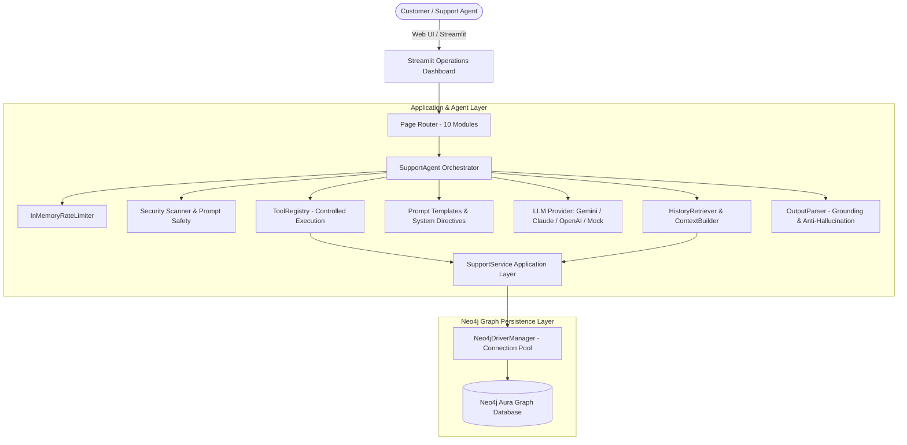
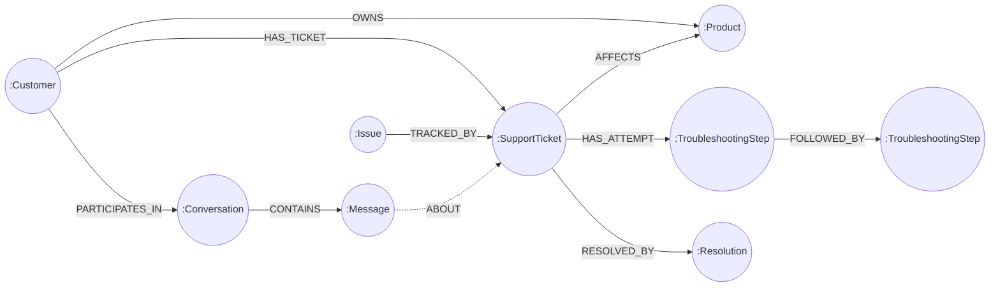

# GraphSupport AI — Hackathon Presentation & Live Demo Guide

**A Context-Aware AI Customer Support System Powered by Neo4j Knowledge Graphs & LLM Reasoning**

---

## 1. Problem Statement

Modern customer support systems fail customers because they suffer from **session amnesia**. When a user connects to a support agent, explains their problem, attempts complex diagnostic steps (e.g. factory resets, firmware re-flashes, token re-authentications), and disconnects without a full resolution:
- The next time the user reaches out, the AI or human agent starts with a blank slate.
- The customer is asked to repeat basic questions ("What device do you have?", "Have you tried restarting?").
- Failed diagnostic attempts are repeated unnecessarily, driving customer frustration.
- Traditional vector databases (RAG) retrieve fragmented semantic chunks without structural relationships, losing the chronological sequence of diagnostic attempts, ticket status invariants, and device ownership linkages.

---

## 2. Existing Customer-Support Limitations

| Vector RAG / Chatbot Limitation | Real-World Failure |
| :--- | :--- |
| **No Structured Memory** | Vector similarity retrieves similar keywords but cannot distinguish whether a password reset **failed** or **succeeded**. |
| **Repeated Failed Steps** | The agent repeatedly asks the user to "power cycle" or "reset password", ignoring yesterday's failed attempt. |
| **Hallucinated State Changes** | Chatbots claim *"I have resolved your ticket and issued a refund"* without executing an authorized transaction. |
| **Cross-Tenant Data Bleed** | Vector search without strict graph-path boundaries can retrieve another customer's ticket context if symptoms are similar. |
| **Lack of Structural Auditing** | Operators cannot inspect why a decision was made because embeddings are opaque numbers. |

---

## 3. GraphSupport AI Solution

**GraphSupport AI** solves session amnesia by coupling LLM conversational reasoning with a **persistent, property-graph memory layer in Neo4j**:

1. **Persistent Customer Knowledge Graph**: Tracks `:Customer`, `:Product`, `:Issue`, `:SupportTicket`, `:TroubleshootingStep`, `:Resolution`, and `:Conversation` nodes with directed, typed relationships.
2. **Context-Aware Memory Extraction**: Automatically traverses the customer's personal subgraph prior to agent reasoning, extracting open tickets, chronological diagnostic attempts, and explicit failure indicators.
3. **Outcome Invariance**: Failed troubleshooting steps generate diagnostic warning flags in prompt assembly, preventing the agent from repeating failed steps.
4. **Authorized Tool Execution**: State modifications (ticket creation, status updates, troubleshooting records) execute through validated, parameterized application services.
5. **Anti-Hallucination Output Validation**: An `OutputParser` fact-checks responses, preventing the LLM from claiming a ticket was opened or closed unless an authorized tool execution succeeded.
6. **Multi-Tenant Boundary Isolation**: Tool operations and memory queries are strictly pinned to the authenticated customer ID.

---

## 4. Architecture & Graph Data Model

### Architecture Diagram



### Graph Data Model & Relationships



#### Node Properties & Ticket Lifecycle
- **`:Customer`**: `id`, `name`, `email`, `tier` (`standard`, `pro`, `enterprise`), `created_at`
- **`:Product`**: `id`, `name`, `sku`, `category`, `version`
- **`:SupportTicket`**: `id`, `title`, `description`, `status` (`open` ➔ `in_progress` ➔ `resolved` ➔ `closed`), `priority`
- **`:TroubleshootingStep`**: `id`, `step_number`, `action`, `outcome` (`failed`, `success`, `partial`, `unknown`), `notes`, `executed_at`
- **`:Resolution`**: `id`, `summary`, `resolution_type`, `verified`, `created_at`
- **`:Conversation`**: `id`, `channel`, `status`, `started_at`
- **`:Message`**: `id`, `sender_type` (`customer`, `assistant`), `content`, `timestamp`

---

## 5. Live End-to-End Demo Walkthrough

### Demonstration Scenario: Sarah Chen (Login Failure & Prior Reset Attempt)

This realistic scenario showcases why graph memory is transformative for customer experience:

#### Step 1: Pre-Condition (Conversation 1)
- **Customer**: Sarah Chen (`demo-cust-sarah`), Enterprise Customer.
- **Product**: SmartMesh Home Gateway Pro (`SM-GW-PRO`).
- **Issue**: Cannot log in to the cloud admin portal.
- **Action Attempted**: Password reset email was dispatched.
- **Outcome**: **FAILED** (Token expired immediately upon clicking, returning HTTP 401 Unauthorized).
- **Status**: Ticket `demo-tkt-101` remains **OPEN**.

#### Step 2: The Follow-Up (Conversation 2)
- Sarah initiates a new chat session hours later and simply types:
  > *"My account still isn't working."*
- **What a standard chatbot does**: *"I'm sorry to hear that! What device do you have? Have you tried resetting your password?"* (Causes frustration).
- **What GraphSupport AI does**:
  1. Retrieves Sarah's graph memory (`demo-tkt-101`, open status, Step 1 failed).
  2. Flags `ticket_demo-tkt-101_has_failed_attempt_step_1` in prompt assembly.
  3. LLM acknowledges the past attempt: *"Welcome back, Sarah. I see from ticket demo-tkt-101 that the password reset link previously failed due to an immediate expiration (HTTP 401). Rather than sending another reset link, let's flush your active session tokens or generate an administrative bypass key."*

### Demo Execution Sequence for Presenters

1. **Terminal Command to Seed Scenario**:
   ```bash
   python scripts/seed_demo.py
   ```
2. **Open Dashboard**:
   ```bash
   streamlit run app.py
   ```
3. **Walk Through the UI**:
   - **Overview Page (`📊 Overview`)**: Observe live graph metrics (Customers, Products, Tickets, Active Demo banner).
   - **Support Chat (`💬 Support Chat`)**:
     - Select Persona: `Sarah Chen (sarah.chen@example.com) [demo-cust-sarah]`.
     - Select Active Session: `demo-conv-session-2`.
     - Type: *"My account still isn't working."*
     - Observe the context-aware response acknowledging the failed password reset link!
   - **Graph Explorer (`🕸️ Graph Explorer`)**:
     - Select `demo-cust-sarah` to visualize the live Neo4j subgraph connecting Sarah ➔ SmartMesh Gateway ➔ Ticket #101 ➔ Failed Step #1.
   - **Evaluation (`📈 Evaluation`)**:
     - Click **Run System Benchmark** to showcase all 9 automated verification vectors passing at 100%.

---

## 6. Why Neo4j Graph Memory Matters

1. **Temporal & Sequential Traversal**: Graphs naturally store chains of diagnostic steps (`(step1)-[:FOLLOWED_BY]->(step2)`), enabling the AI to know the order of attempted interventions.
2. **Hard State Boundaries**: Status is a discrete property (`status: 'open'`), not a fuzzy vector similarity score. Tickets cannot be "sort of" closed.
3. **Explainable Retrieval**: Operators can inspect the exact traversal path (Customer ➔ Ticket ➔ Step) that informed the prompt, providing 100% auditability.
4. **Instant Subgraph Bounding**: Neo4j parameterization allows isolating queries to `(:Customer {id: $cid})`, mathematically preventing cross-tenant data exposure.

---

## 7. Actual Measured Evaluation Metrics

*Measured on macOS Monterey using the deterministic 9-vector evaluation suite (`python -c "from graphsupport.application.evaluation import EvaluationRunner..."`):*

| # | Benchmark Vector | Category | Score | Latency | Result |
| :---: | :--- | :--- | :---: | :---: | :---: |
| 1 | **Context Retrieval Relevance & Ticket Ranking** | Memory Retrieval | **100%** | 0.31 ms | **PASSED** |
| 2 | **Diagnostic Outcome Fidelity (Failed Step Invariance)** | Diagnostic Integrity | **100%** | 0.10 ms | **PASSED** |
| 3 | **Ticket Status & Lifecycle Transition Validity** | Domain Integrity | **100%** | 0.03 ms | **PASSED** |
| 4 | **Groundedness & Unsupported Claim Detection** | Groundedness | **100%** | 0.21 ms | **PASSED** |
| 5 | **Customer Data Isolation & Tenant Boundaries** | Security & Privacy | **100%** | 1.18 ms | **PASSED** |
| 6 | **Tool Argument Validation & Safe Execution** | Security & Validation | **100%** | 1.25 ms | **PASSED** |
| 7 | **Prompt Injection Defense & Delimiter Isolation** | Security | **100%** | 0.13 ms | **PASSED** |
| 8 | **Service Resilience & Privacy-Safe Error Handling** | Resilience | **100%** | 0.03 ms | **PASSED** |
| 9 | **Retrieval & Context Assembly Latency** | Performance | **100%** | 0.35 ms | **PASSED** |
| **TOTAL** | **Full Benchmark Suite (9/9 Vectors)** | **Overall System** | **100%** | **3.59 ms** | **PASSED** |

- **Unit Test Suite**: **129 passing unit tests** (0 failures, 0 skips).
- **Integration Test Suite**: **10 passing integration tests** across live Neo4j Aura and startup checks.
- **Total Automated Test Count**: **139 passing tests**.

---

## 8. Security & Privacy Considerations

1. **Strict Parameterized Cypher**: User inputs are never concatenated into raw Cypher strings.
2. **Allowlisted Safe Entity IDs**: All IDs are validated against `^[a-zA-Z0-9_\-\.]{1,128}$`, preventing Cypher injection keywords (`DROP`, `MATCH`, `DELETE`) and null bytes.
3. **Deduplication Safeguards**: `create_support_ticket` checks for existing active tickets with identical titles; `record_troubleshooting_attempt` detects duplicate step numbers and actions.
4. **Secret Masking & Privacy Redaction**: Loggers and error messages automatically scrub credit cards, API keys, and connection credentials (`neo4j+s://...`).
5. **Prompt Injection Heuristics**: Incoming messages are scanned for instruction overrides, persona hijacking ("DAN"), and system prompt harvesting.

---

## 9. Known Limitations

1. **Development Identity Boundary**: Customer switching in the Streamlit UI is currently an operator dropdown. In enterprise deployment, this boundary must be replaced by OAuth2 / OIDC JWT session claims.
2. **In-Memory Rate Limiting**: The sliding-window rate limiter is in-process Python memory; multi-worker cloud deployments require centralized Redis token buckets.
3. **LLM Provider Costs**: Live LLM reasoning requires valid API keys (Gemini, Claude, or OpenAI). In mock mode, deterministic offline fixtures are utilized.
4. **Prompt Injection Inherent Limits**: No heuristic regex can guarantee 100% elimination of novel adversarial jailbreaks. Allowlisted tool execution and strict output validation provide the backstop.

---

## 10. Future Improvements

1. **OAuth2 / OIDC Integration**: Direct integration with Okta, Auth0, or Google Workspace for SSO customer authentication.
2. **Automated Vector-Graph Hybrid Traversal**: Combining Neo4j vector indexes on issue embeddings with graph path traversals for hybrid semantic-structural retrieval.
3. **Voice / Phone Channel Integration**: Webhook connectors for telephony APIs (Twilio, Amazon Connect) feeding speech-to-text directly into the graph memory pipeline.
4. **Enterprise SLA Escalation Engine**: Automated background worker that evaluates ticket aging against SLA thresholds and triggers alert webhooks (PagerDuty / Slack).

---

## 11. Recommended Screenshot Checklist for Pitch Deck

When capturing screens for pitch slides:
1. **Overview Page**: Showing live counts, tickets breakdown, and the active Hackathon Demo status banner.
2. **Support Chat Page**: Sarah Chen's conversation showing the agent acknowledging ticket `demo-tkt-101` and the failed password reset attempt.
3. **Graph Explorer Page**: Interactive graph visualization displaying the node cluster for `demo-cust-sarah` ➔ `demo-tkt-101` ➔ `demo-step-101-1`.
4. **Evaluation Dashboard**: The 9-benchmark table showing 100% score and execution latencies.
5. **System Health Page**: All subsystems reporting green (Core Runtime, Neo4j Aura live connection, and configuration checks).
